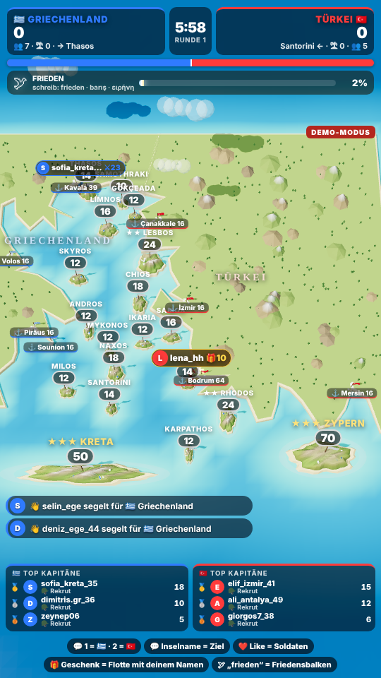

# Ägäis: Kampf um den Frieden (TikTok-LIVE-Spiel, 3D)

🇬🇷 Griechenland und 🇹🇷 Türkei schicken ihre Flotten von den Festland-Häfen auf 19 Inseln.
Zypern ist der Hauptpreis (5 Punkte). **Am Ende jeder Runde gewinnt immer der Frieden.**

## Online-Demo (ohne TikTok)
**▶ https://cembot90.github.io/aegean-island-live/**

Der Link läuft im Demo-Modus mit simulierten Zuschauern, auch auf dem Handy. Testtasten am PC: `Q` / `W` = Geschenk, `F` = Frieden, `P` = Friedensgipfel.
Die alte Götter-Version: https://cembot90.github.io/aegean-island-live/goetter.html?demo=1

 

## So spielen die Zuschauer
| Aktion | Wirkung |
|---|---|
| `1` / `2` / 🇬🇷 / 🇹🇷 (oder „griechenland“, „türkei“, „yunanistan“ …) | Seite wählen |
| Inselname (`zypern`, `kıbrıs`, `kreta`, `girit`, `rodos`, `ρόδος` …) | Ziel der eigenen Flotte |
| Kommentar | +3 Soldaten |
| Like | +1 Soldat und ein bisschen Frieden |
| Geschenk | goldene Flotte **mit Profilbild und Namen** des Schenkenden (5 Soldaten pro Diamant) |
| `frieden` / `barış` / `ειρήνη` / `peace` / 🕊 | füllt den Friedensbalken |

## Damit sich die Spieler sehen
- Jede Flotte hat einen **Kapitän**, einen echten Zuschauer mit Profilbild und Namen.
- Wer eine Insel erobert, wird **👑 Gouverneur** und steht mit Bild auf der Insel.
- **Ränge:** 🪖 Rekrut, ⚓ Matrose, 🧭 Bootsmann, 🎖 Kapitän, ⭐ Admiral, 👑 Legende. Jeder Aufstieg wird angezeigt. Die Ränge bleiben den ganzen Stream lang erhalten.
- Eine **große Geschenk-Karte** mit Profilbild erscheint mitten im Bild, die Kamera fährt bei großen Momenten heran.
- Es gibt Like-Combos, Seeschlachten zwischen Flotten und eine Top-3-Rangliste pro Seite.

## Zypern-Krise
Alle 75 Sekunden kommt eine Zypern-Krise: 20 Sekunden lang fahren alle Flotten nach Zypern, und jeder Angriff zählt doppelt.

## Friedensgipfel
Die Runde endet, wenn der Friedensbalken voll ist, die Zeit abläuft (6 Minuten) oder eine Seite alle Inseln hält.
Dann werden alle Segel und Flaggen weiß, Tauben fliegen über die Ägäis, und es erscheint
„FRIEDEN GEWINNT · Ειρήνη · Barış · Frieden“. Geehrt werden der oder die **Friedensstifter·in**
und die tapferste Person jeder Seite. Ein Zähler hält fest, wie viele Friedensverträge im Stream geschlossen wurden.

## Starten
Du brauchst Node.js 20 oder neuer.
```bash
npm install
node server.js DEIN_TIKTOK_NAME
```
Dann `http://localhost:8787` als Browser-Quelle in OBS oder TikTok LIVE Studio einfügen (1080×1920).

- Testen ohne TikTok: `http://localhost:8787/?demo=1`
- Testtasten: `Q` = Geschenk 🇬🇷, `W` = Geschenk 🇹🇷, `F` = Friedenskommentar, `P` = Friedensgipfel sofort, `D` = Demo an/aus
- URL-Optionen: `?round=300` (Rundendauer in Sekunden), `?peace=800` (Größe des Friedensbalkens)
- Alle Werte findest du im Block `CONFIG` oben in `index.html`.
- Die alte Version mit vier Götter-Teams liegt in `goetter.html`.

## Hinweise
- `tiktok-live-connector` ist inoffiziell und kann nach TikTok-Updates ausfallen.
- Das Spiel zeigt keine Kommentartexte an, nur Namen und Profilbilder. Bei einem Thema mit nationalen Gefühlen solltest du trotzdem Moderatoren und die TikTok-Wortfilter für deinen Chat einschalten.
