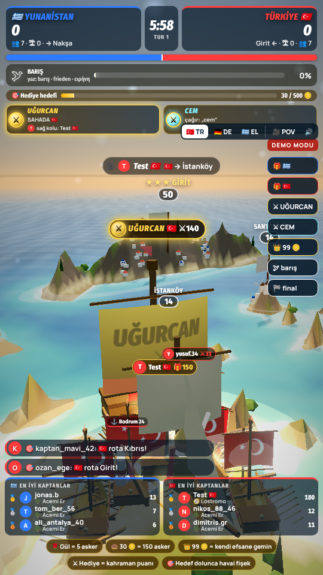
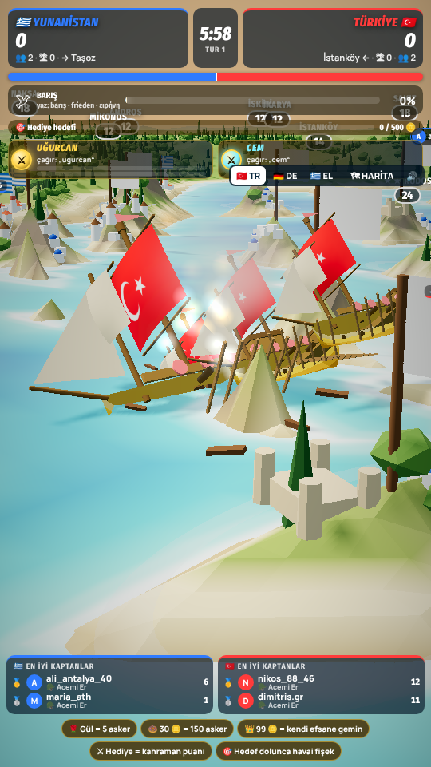
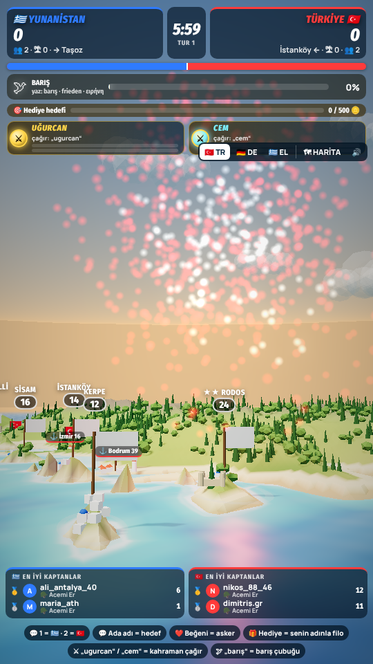
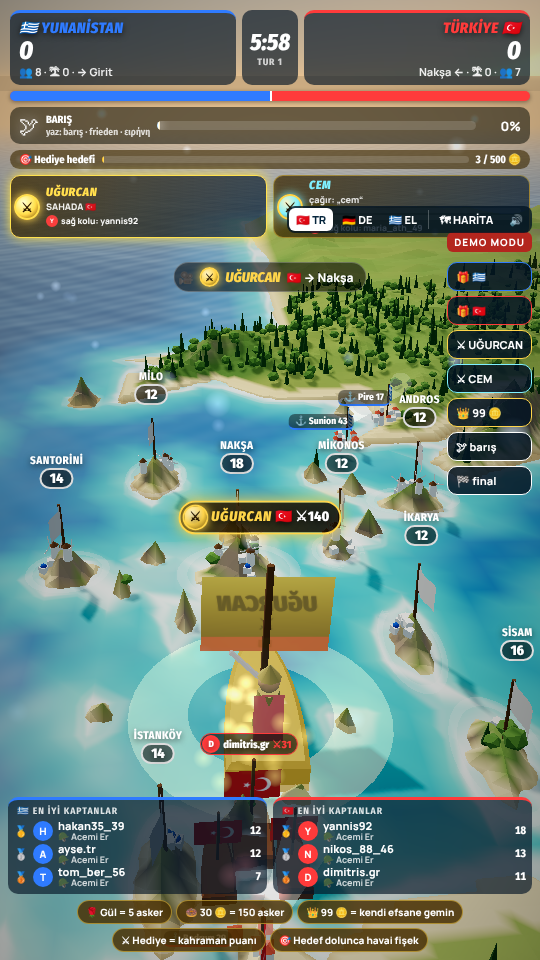
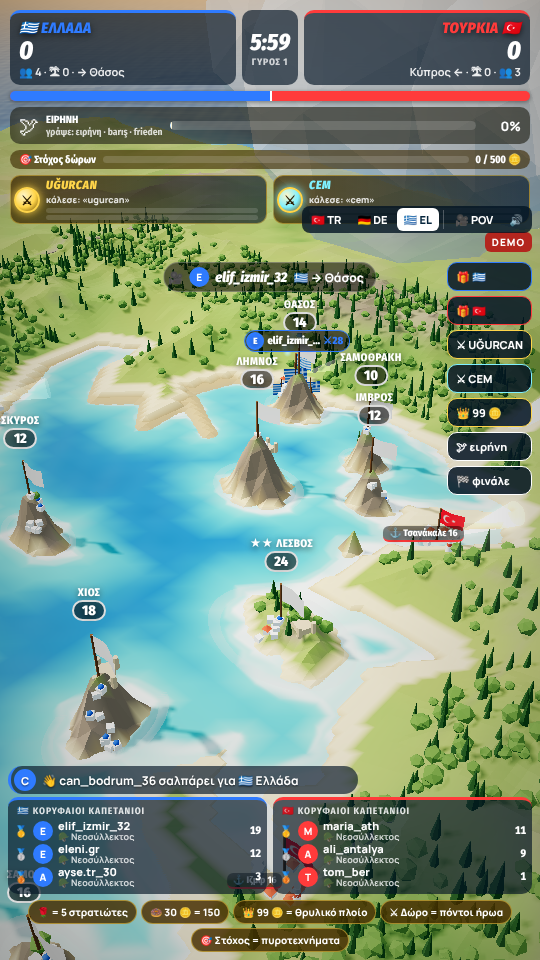
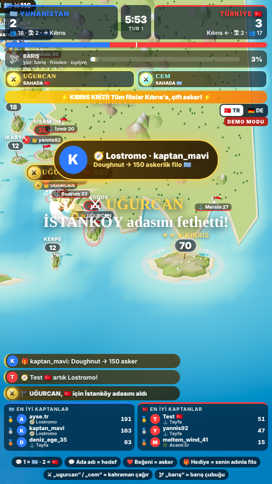
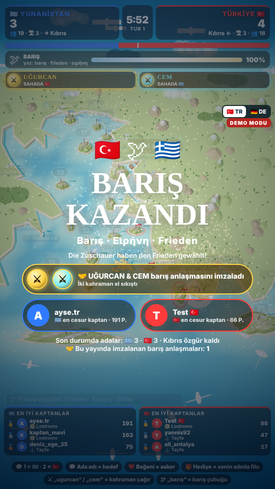

# Ägäis: Kampf um den Frieden (TikTok-LIVE-Spiel, 3D)

🇬🇷 Griechenland und 🇹🇷 Türkei schicken ihre Flotten von den Festland-Häfen auf 19 Inseln.
Zypern ist der Hauptpreis (5 Punkte). **Am Ende jeder Runde gewinnt immer der Frieden.**

## Online-Demo (ohne TikTok)
**▶ https://cembot90.github.io/aegean-island-live/**

Der Link läuft im Demo-Modus mit simulierten Zuschauern, auch auf dem Handy. Am Handy tippst du auf die Knöpfe rechts. Am PC gehen auch Tasten: `Q` / `W` = Geschenk, `U` / `C` = Helden, `K` = Legendenschiff, `F` = Waffenruhe, `P` = Finale, `L` = Sprache, `M` = Ton.
Die alte Götter-Version: https://cembot90.github.io/aegean-island-live/goetter.html?demo=1

       

## Neu: Extras für mehr Beteiligung
| Extra | So funktioniert es |
|---|---|
| 🔊 **Sound** | Kanonen, Fanfaren, Heldenhorn, Donner, Möwen und Friedensmusik, alles im Browser erzeugt (keine Musikrechte). Ein- und ausschalten mit 🔊 oder der Taste `M`, aus mit `?sound=0`. |
| 🌪 **UĞURCANs Sturm** | Wenn er gerufen wird, fahren 10 Sekunden lang alle gegnerischen Schiffe nur halb so schnell, mit Regen und Blitzen. |
| 🛡 **CEMs Schild** | 20 Sekunden lang ist die wertvollste Insel seiner Seite unangreifbar. Hat die Seite noch keine Insel, schützt er die erste Insel, die er erobert. |
| 🤝 **Rechte Hand** | Wer einen Helden am meisten gerufen hat, steht mit Bild und Namen neben dem Helden („sağ kolu“). |
| 🕊 **Waffenruhe** | Schreiben beide Seiten innerhalb von 10 Sekunden je dreimal „barış“, halten alle Schiffe 8 Sekunden an, und Tauben fliegen über Zypern. |
| 👑 **Legendenschiff** | Wer in einer Runde 99 🪙 (Coins) schenkt, bekommt ein eigenes großes Schiff mit Profilbild und Namen im Segel, das doppelt so hart trifft (ein Schiff pro Person und Runde, fester Wert, kein Zufall). |
| 🎯 **Geschenkziel** | Ein Balken pro Runde (Standard 500 🪙 Coins, ändern mit `?goal=800`). Ist er voll, gibt es ein Feuerwerk und einen Dank an die drei größten Unterstützer·innen. |
| 🎁 **Geschenk-Menü** | Die Hilfezeile wechselt alle 8 Sekunden zwischen Steuerung und den Geschenkwerten („🌹 Gül = 5 asker“ …). |
| 🏆 **Ränge über alle Streams** | `server.js` speichert Punkte in `data/ranks.json` auf deinem Rechner. Stammzuschauer steigen so über mehrere Streams zu Kapitän, Amiral und Efsane auf. |
| 📊 **Deine Statistik** | `http://localhost:8787/stats` zeigt Geschenkwert, geschätzte Diamanten und Dollar sowie die Top-Unterstützer. Die Seite ist nur für dich und nur auf deinem Rechner erreichbar. |
| 📱 **Demo-Knöpfe** | Im Demo-Modus gibt es rechts Knöpfe zum Antippen (Geschenk, Helden, Legendenschiff, Frieden, Finale), damit man die Demo auch am Handy spielen kann. |

## Grafik, Kamera und Sprachen
- **Kamera (Knopf 🗺/🎥/🔄 oben rechts, Taste `V`, oder `?cam=map|pov|auto`):**
  - 🗺 **Karte**: Blick von oben auf die ganze Ägäis.
  - 🎥 **POV**: Die Kamera fliegt hinter einem Schiff her, bevorzugt hinter Helden, Legendenschiffen und Geschenk-Flotten. Oben steht, wessen Schiff gerade gefilmt wird („🎥 ayse.tr 🇹🇷 → Girit“).
  - 🔄 **Auto** (Standard): wechselt zwischen Karte (18 s) und POV (14 s) und springt in POV, sobald ein Held oder ein Legendenschiff losfährt.
  - Die Taste `V` funktioniert auch im echten Stream.
- **Gelände**: Festland und Inseln sind eine zusammenhängende 3D-Landschaft mit Bergen, Stränden, Wäldern, Dörfern, Windmühlen, Burgen und Leuchttürmen. Dazu kommen genauere Küsten (Dardanellen, Euböa, Kreta, Zypern mit Karpas-Halbinsel) und kleine Deko-Inseln.
- **Schiffe**: Jedes Schiff hat zwei Masten mit gewölbten Segeln (das Großsegel zeigt die Flagge), Achterkastell, Bugspriet, Schilde in der Teamfarbe, eine Hecklaterne und Ruderreihen, die rudern. Bei Seeschlachten und Angriffen feuern die Kanonen Breitseiten mit Mündungsfeuer und Rauchwolken. Helden- und Legendenschiffe sind golden und groß.
- **Versenkte Schiffe**: Sie kippen zur Seite, brennen und sinken. Planken treiben auf den Wellen, Luftblasen steigen auf, dazu gibt es ein Knarz- und Wassergeräusch.
- **Feuerwerk**: Bei jeder Eroberung steigen Raketen mit Leuchtspur auf und zerplatzen in der Teamfarbe (Rot oder Blau mit Weiß). Wertvolle Inseln bekommen mehr Raketen. Auch das Geschenkziel und das Friedensfinale werden mit Feuerwerk gefeiert.
- **Wasser und Himmel**: Wellen und Schaum an den Stränden, Abendhimmel mit Sonne am Horizont und ein dezentes Glühen (`?fx=0` schaltet es aus).
- **Langsamer Rechner?** Mit `?q=low` gibt es weniger Bäume, keine Effekte und eine geringere Auflösung.
- **Sprachen**: 🇹🇷 Türkisch (Standard), 🇩🇪 Deutsch, 🇬🇷 Griechisch. Umschalten mit dem Knopf, der Taste `L` oder `?lang=tr|de|el`.

## Rechtliches & Lizenz
Lies **[RECHTLICHES.md](RECHTLICHES.md)**, bevor du damit Geld verdienst. Die Lizenzen stehen in [LIZENZ.md](LIZENZ.md) und [THIRD_PARTY_NOTICES.md](THIRD_PARTY_NOTICES.md).
Kurz: Das Spiel gehört dir, `server.js` steht unter der AGPL-3.0, und die TikTok-Anbindung ist inoffiziell.

## Sprache: Türkisch, Deutsch oder Griechisch
Standard ist **Türkisch**. Umschalten kannst du so:
- mit dem Knopf **🇹🇷 TR / 🇩🇪 DE** oben rechts (die Wahl wird gespeichert),
- mit der Taste `L`,
- über die Adresse: `?lang=tr`, `?lang=de` oder `?lang=el`.

Sobald `server.js` mit TikTok verbunden ist, wird der Knopf ausgeblendet, damit er nicht im Stream zu sehen ist.
Mit `?ui=0` verschwindet er immer. Den Standard änderst du in `CONFIG.defaultLang`.

## Die Helden UĞURCAN und CEM
- Zuschauer rufen einen Helden, indem sie `ugurcan` oder `cem` kommentieren. Jeder Kommentar bringt 1 Ruf-Punkt.
- Geschenke laden den Helden mit auf, den man zuletzt gerufen hat (1 Punkt pro Coin Geschenkwert).
- Bei 25 Punkten erscheint der Held für **die Seite, die ihn gerufen hat**. Er kommt auf einem großen goldenen Schiff mit seinem Namen im Segel und einem Krieger an Deck.
- Ein Held versenkt normale Flotten bei Berührung, kämpft doppelt so stark und erobert bis zu 3 Inseln hintereinander. Danach ruht er 40 Sekunden.
- Treffen UĞURCAN und CEM auf verschiedenen Seiten aufeinander, gibt es ein **Helden-Duell**.
- Im Finale unterschreiben beide gemeinsam den Frieden.
- Feste Seite? In `HEROES` bei `side` eine `1` (Türkei) oder `0` (Griechenland) statt `null` eintragen.
- Testtasten: `U` ruft UĞURCAN für 🇹🇷, `C` ruft CEM für 🇬🇷.

## So spielen die Zuschauer
| Aktion | Wirkung |
|---|---|
| `1` / `2` / 🇬🇷 / 🇹🇷 (oder „griechenland“, „türkei“, „yunanistan“ …) | Seite wählen |
| Inselname (`zypern`, `kıbrıs`, `kreta`, `girit`, `rodos`, `ρόδος` …) | Ziel der eigenen Flotte |
| Kommentar | +3 Soldaten |
| Like | +1 Soldat und ein bisschen Frieden |
| Geschenk | goldene Flotte **mit Profilbild und Namen** des Schenkenden (5 Soldaten pro Coin Geschenkwert) |
| `frieden` / `barış` / `ειρήνη` / `peace` / 🕊 | füllt den Friedensbalken |

## Damit sich die Spieler sehen
- Jede Flotte hat einen **Kapitän**, einen echten Zuschauer mit Profilbild und Namen.
- Wer eine Insel erobert, wird **👑 Gouverneur** und steht mit Bild auf der Insel.
- **Ränge:** 🪖 Rekrut, ⚓ Matrose, 🧭 Bootsmann, 🎖 Kapitän, ⭐ Admiral, 👑 Legende. Jeder Aufstieg wird angezeigt. Die Ränge bleiben den ganzen Stream lang erhalten.
- Eine **große Geschenk-Karte** mit Profilbild erscheint mitten im Bild, die Kamera fährt bei großen Momenten heran.
- Es gibt Like-Combos, Seeschlachten zwischen Flotten und eine Top-3-Rangliste pro Seite.

## Zypern-Krise
Alle 75 Sekunden kommt eine Zypern-Krise: 20 Sekunden lang fahren alle Flotten nach Zypern, und jeder Angriff zählt doppelt.

## Friedensgipfel
Die Runde endet, wenn der Friedensbalken voll ist, die Zeit abläuft (6 Minuten) oder eine Seite alle Inseln hält.
Dann werden alle Segel und Flaggen weiß, Tauben fliegen über die Ägäis, und es erscheint
„FRIEDEN GEWINNT · Ειρήνη · Barış · Frieden“. Geehrt werden der oder die **Friedensstifter·in**
und die tapferste Person jeder Seite. Ein Zähler hält fest, wie viele Friedensverträge im Stream geschlossen wurden.

## Starten
Du brauchst Node.js 20 oder neuer.
```bash
npm install
node server.js DEIN_TIKTOK_NAME
```
Dann **`http://localhost:8787/?demo=0`** als Browser-Quelle in OBS oder TikTok LIVE Studio einfügen (1080×1920).
`demo=0` sorgt dafür, dass im echten Stream niemals simulierte Zuschauer erscheinen. Verdeckt TikToks Chat den unteren Rand, häng `&bottom=120` an.

Beim ersten echten Live einmal so starten, um die Geschenkwerte zu prüfen: `DEBUG_GIFTS=1 node server.js DEIN_TIKTOK_NAME`

- Testen ohne TikTok: `http://localhost:8787/?demo=1`
- Testtasten: `Q` / `W` = Geschenk 🇬🇷 / 🇹🇷, `U` / `C` = UĞURCAN / CEM, `F` = Friedenskommentar, `P` = Friedensgipfel sofort, `L` = Sprache, `D` = Demo an/aus
- URL-Optionen: `?round=300` (Rundendauer in Sekunden), `?peace=800` (Größe des Friedensbalkens)
- Alle Werte findest du im Block `CONFIG` oben in `index.html`.
- Die alte Version mit vier Götter-Teams liegt in `goetter.html`.

## Hinweise
- `tiktok-live-connector` ist inoffiziell und kann nach TikTok-Updates ausfallen.
- Das Spiel zeigt keine Kommentartexte an, nur Namen und Profilbilder. Bei einem Thema mit nationalen Gefühlen solltest du trotzdem Moderatoren und die TikTok-Wortfilter für deinen Chat einschalten.
